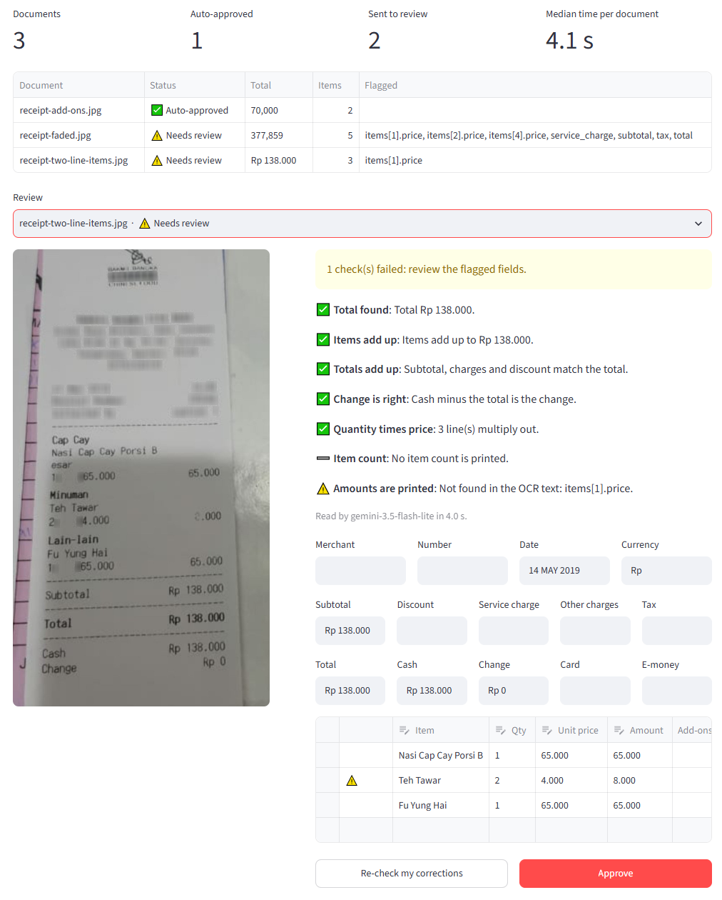
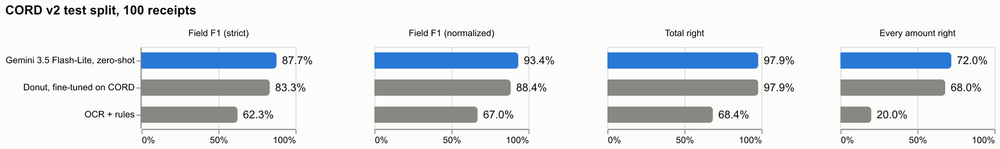
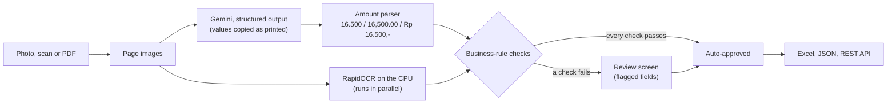

# InvoiceIQ 🧾

**Document AI that reads receipts and invoices into structured data, checks every number, and
sends anything that does not add up to a human.**

[](https://github.com/amnanazir101-maker/invoiceiq/actions/workflows/ci.yml)


-555)


Upload a photo, scan or PDF. Gemini reads it straight into a typed schema, copying every value
exactly as printed. Deterministic code then turns that text into numbers and checks what the
document itself promises: the items add up to the subtotal, the subtotal plus tax and service
is the total, cash minus the total is the change, and every amount is actually printed on the
page according to an independent local OCR pass. Receipts that pass every check are approved
automatically; the rest open in a review screen that names the fields to look at. Results
export to Excel or JSON, and a REST API serves the same pipeline.



*On this receipt one line amount is hidden by the dataset's privacy blur. Gemini filled it in
as 8.000 (2 × 4.000), which makes every sum add up, but the amount is not printed on the page,
so the OCR check flags that one field for a person to confirm.*

## Results



Scored on the **CORD v2 test split**: 100 receipts photographed in Indonesian shops and
restaurants, with every field labelled. All three readers run through the same pipeline and the
same evaluator.

| Reader | Training on CORD | Field F1 | F1, normalized | Total right | Every amount right | Seconds per receipt |
|---|---|---:|---:|---:|---:|---:|
| **Gemini 3.5 Flash-Lite, zero-shot** (default) | none | **87.7%** | **93.4%** | **97.9%** | **72.0%** | 3.1 |
| Donut, fine-tuned on CORD | 800 labelled receipts | 83.3% | 88.4% | 97.9% | 68.0% | 22.0 |
| OCR + rules (classic approach) | rules written on the validation split | 62.3% | 67.0% | 68.4% | 20.0% | 3.0 |

- **Zero-shot beats fine-tuned.** With no training data, Gemini scores 4.4 points of field F1
  above Donut, a model trained on CORD's 800 training receipts and their exact labelling
  conventions. It returns a receipt in about 3 seconds, against 22 for Donut on a laptop CPU,
  at no cost on the free tier.
- **The classic pipeline breaks on real photos.** OCR followed by keyword rules gets the total
  right on 68% of receipts and every amount right on only 20%: skewed photos merge lines,
  wrapped names split items, and quantities in their own column are missed.

The business-rule checks decide which receipts a person needs to see:

| Reader | Auto-approved | Every amount right when auto-approved | Wrong receipts sent to review |
|---|---:|---:|---:|
| Gemini 3.5 Flash-Lite | 75.0% | 77.3% | 39.3% |
| Donut, fine-tuned on CORD | 63.0% | 85.7% | 71.9% |
| OCR + rules | 43.0% | 46.5% | 71.2% |

The checks catch most of Donut's and the OCR pipeline's mistakes, which tend to break a sum.
Gemini's remaining differences from the labels mostly put a correct number in a neighbouring
field (an add-on's price on the item line, a rounding line as a surcharge) or leave out a
payment line, which no sum can reveal. That is why every auto-approved receipt still carries
its full list of checks in the export.

How the numbers were measured:

- **Field F1** follows the protocol of the Donut paper: both JSON trees are flattened into
  (field, value) pairs such as `menu.price = "16,500"`, a prediction counts only if the label
  holds the identical pair, and counts are pooled over all receipts. CORD's labels keep each
  receipt's own spelling, including a few OCR-style slips (`IVINERAL WATER` for MINERAL WATER),
  so no reader can reach 100%.
- **F1, normalized** compares what a ledger stores: amounts as numbers (`Rp 16.500` = `16500`),
  counts as numbers and names without case, spaces or punctuation.
- **Total right** counts receipts whose grand total is right as a number. **Every amount
  right** requires every price, subtotal, tax, charge, total, cash and change on the receipt to
  match its label.
- The Gemini prompt, the OCR rules and the checks were developed on the validation split, and
  the test split was scored once. Every prediction, with its review, is in
  [`results/`](results/).
- Donut and the OCR pipeline ran on a 2-core laptop CPU (Intel Core i3). Gemini's time is the
  free-tier API round trip, with the local OCR running alongside it.
- CORD has been public since 2019. Donut was trained on its training split; a web-scale model
  such as Gemini may also have seen some of its images.

## How it works



- **Copy, then compute.** The model only copies what is printed; Python turns "Rp. 16.500,-",
  "16,500.00", "@11000" and "(5,000)" into numbers. Every number can be traced back to the
  characters it came from, and the parser is unit-tested on the formats real receipts use.
- **Checks that recompute the document.** Six rules (a total is present, items add up, totals
  add up, the change is right, quantity times unit price, the printed item count) allow for the
  ways real receipts differ: tax-inclusive prices, priced add-ons, discounts and rounding lines.
- **An independent second reader.** Local OCR reads the page while Gemini works. An amount that
  Gemini returns but OCR cannot find on the page is flagged, which catches a misread digit even
  when the arithmetic happens to agree.
- **One interface, three readers.** Gemini, a fine-tuned Donut model and a classic OCR + rules
  pipeline implement the same `Extractor` protocol, so the app, the API and the benchmark treat
  them identically.
- **Built for the free tier.** A per-minute limit is waited out on the same model, which keeps a
  benchmark on one model; a used-up daily quota moves to the next model in a fallback list; a
  benchmark run that stops resumes where it left off.

## Quickstart

```bash
git clone https://github.com/amnanazir101-maker/invoiceiq.git
cd invoiceiq
python -m venv .venv
.venv\Scripts\activate              # macOS/Linux: source .venv/bin/activate
pip install -e ".[app,dev]"
copy .env.example .env              # macOS/Linux: cp .env.example .env
```

Add a free Gemini key from [Google AI Studio](https://aistudio.google.com/apikey) to `.env`,
then start the web app:

```bash
streamlit run app.py                # http://localhost:8501
```

Upload receipts or invoices (or press **Try the sample receipts**), correct anything that is
flagged, and download the results as an Excel workbook with receipts, items and checks.

### Command line

```bash
invoiceiq extract examples/receipt-add-ons.jpg
invoiceiq extract scans/*.pdf --excel receipts.xlsx --json receipts.json
invoiceiq extract receipt.jpg --extractor ocr-rules     # local, no API key needed
```

### REST API

```bash
invoiceiq serve                     # interactive docs at http://127.0.0.1:8000/docs
curl -F "file=@examples/receipt-add-ons.jpg" http://127.0.0.1:8000/v1/extract
```

The response keeps every value exactly as printed (`receipt`), the same data as numbers
(`values`), and the review. Abridged from [`docs/example-output.json`](docs/example-output.json):

```json
{
  "file": "receipt-add-ons.jpg",
  "status": "approved",
  "receipt": {
    "items": [
      {"name": "[LG] BLACK SAKURA", "quantity": "1", "price": "59,091",
       "sub_items": [{"name": "LONGAN", "quantity": "1", "price": "0"}, "..."]},
      {"name": "MINERAL WATER (bundling) 5k", "quantity": "1", "price": "4,545"}
    ],
    "subtotal": "63,636", "tax": "6,364", "total": "70,000", "cash": "100,000", "change": "30,000"
  },
  "values": {"subtotal": 63636.0, "tax": 6364.0, "total": 70000.0, "cash": 100000.0, "change": 30000.0},
  "review": {
    "status": "approved",
    "checks": [
      {"name": "Items add up", "status": "pass", "detail": "Items add up to 63,636."},
      {"name": "Amounts are printed", "status": "pass", "detail": "Every amount appears in the OCR text."}
    ],
    "flagged": []
  },
  "model": "gemini-3.5-flash-lite"
}
```

### Docker

```bash
docker compose up                   # API on :8000, web app on :8501, key read from .env
```

### Configuration

Settings are read from the environment or `.env` (see [`.env.example`](.env.example)):

| Variable | Default | Meaning |
|---|---|---|
| `GEMINI_API_KEY` | | free key from Google AI Studio |
| `INVOICEIQ_EXTRACTOR` | `gemini` | reader used by the app and the API: `gemini`, `donut` or `ocr-rules` |
| `INVOICEIQ_GEMINI_MODEL` | `gemini-3.5-flash-lite` | main Gemini model |
| `INVOICEIQ_GEMINI_FALLBACK_MODELS` | `gemini-3.1-flash-lite,...` | models to switch to when a daily quota runs out |
| `INVOICEIQ_THINKING_LEVEL` | `low` | Gemini 3 thinking level |
| `INVOICEIQ_CHECK_PRINTED` | `true` | confirm every amount against local OCR of the page |
| `INVOICEIQ_TOLERANCE` | `0.005` | tolerance of the arithmetic checks, as a share of the bill |

## Reproduce the benchmark

The dataset is downloaded from Hugging Face on first use (only the split you ask for).

```bash
invoiceiq benchmark --extractor ocr-rules       # classic baseline, local CPU
pip install -e ".[donut]"
invoiceiq benchmark --extractor donut           # fine-tuned specialist, local CPU
invoiceiq benchmark --extractor gemini          # zero-shot, free tier; resumes after a daily limit
invoiceiq compare                               # the tables above
```

Every prediction is stored in `results/<run>/predictions.jsonl` with its review, and
`metrics.json` holds the scores, including F1 per field.

## Project structure

```
src/invoiceiq/
  schema.py          Receipt, LineItem, SubItem: the typed schema (also Gemini's instructions)
  amounts.py         printed text to numbers, for every separator convention
  validation.py      the business-rule checks and the auto-approve decision
  extractors/        gemini.py (structured output, quota-aware), donut.py, ocr_rules.py
  ocr.py             RapidOCR wrapper: line grouping and an optional disk cache
  pipeline.py        extraction and OCR in parallel, then validation
  cord.py            CORD v2 loader and the mapping to and from its labels
  metrics.py         field F1 (Donut protocol), normalized F1, per-receipt metrics
  bench.py           resumable benchmark runner
  api.py             FastAPI service
  export.py          Excel (receipts, items, checks) and JSON
  charts.py          Altair charts for the app and this README
  cli.py             invoiceiq extract | benchmark | compare | serve
app.py               Streamlit app: upload, review, correct, export, benchmark
examples/            three sample receipts from CORD (CC BY 4.0)
results/             predictions and metrics for every test receipt
tests/               offline test suite (no API key or network)
```

## Tests

```bash
pytest -q
```

91 tests run in about two minutes without an API key or network access. They cover:

- the amount parser on the formats real receipts use;
- every business rule, including tax-inclusive prices, discounts, add-ons and rounding;
- the metrics against hand-computed cases, and the mapping to and from CORD's labels;
- Gemini's handling of rate limits, fallbacks, blocked answers and invalid JSON, using a fake
  client;
- the OCR baseline on a rendered receipt with real OCR;
- the REST API, the Excel export, the resumable benchmark runner, the CLI;
- the web app, driven headlessly with Streamlit's test harness.

GitHub Actions runs the tests on Python 3.11 and 3.12, checks linting and formatting with
Ruff, and builds the Docker image.

## Design notes

- **Why receipts from CORD.** CORD v2 is the standard public benchmark for receipt parsing, with
  every field labelled on real photographs, so the numbers above can be checked by anyone. The
  schema also covers invoice fields (merchant, document number, date, currency) for real use.
- **Why the checks are strict.** A wrong amount that is booked costs more than a receipt that a
  person confirms in a few seconds, so any failed check sends the receipt to review. The
  arithmetic tolerance (0.5% of the bill) absorbs rounding lines; a misread digit small enough
  to hide inside it is left to the printed-amounts check.
- **Roadmap.** Invoice-specific fields (due date, tax IDs, line VAT), a second benchmark on
  invoices, and storing reviewer corrections as new training and evaluation data.

## Data and credits

- [CORD v2](https://huggingface.co/datasets/naver-clova-ix/cord-v2) receipts (Park et al., 2019),
  CC BY 4.0.
- [Donut](https://github.com/clovaai/donut) (Kim et al., ECCV 2022), MIT, using the
  `naver-clova-ix/donut-base-finetuned-cord-v2` checkpoint.
- [RapidOCR](https://github.com/RapidAI/RapidOCR) with PP-OCR models, Apache 2.0.

## Author

Built by **Amna Nazir** ([@amnanazir101-maker](https://github.com/amnanazir101-maker)).

## License

[MIT](LICENSE)
